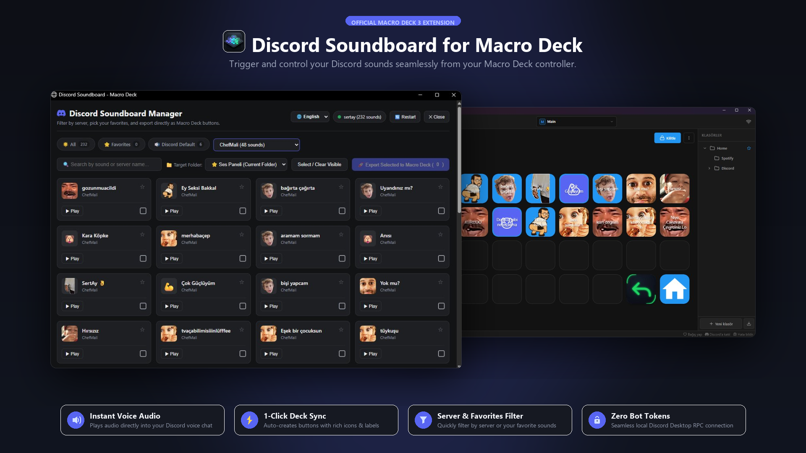

# Discord Soundboard for Macro Deck 3

[](LICENSE)
[](https://macro-deck.app)
[](https://dotnet.microsoft.com)



A high-performance, native Macro Deck 3 plugin that connects to your local Discord client to play Soundboard sounds directly from your Deck buttons. Includes an embedded, interactive visual **Soundboard Manager** window for searching, filtering, previewing, and batch-exporting sounds to any folder.

---

## ✨ Features

- **Direct Discord IPC Connection:** No bots, tokens, or complex API setups required. The plugin communicates directly with your running Discord desktop application via Discord's local IPC RPC protocol.
- **Automatic Soundboard Discovery:** Automatically fetches all soundboard sounds available in your account, including:
  - Default Discord sounds (Airhorn, Ba-Dum-Tss, Cricket, Golf Clap, etc.)
  - Custom sounds from all servers (guilds) you have joined.
  - Nitro-accessible soundboard audio.
- **Embedded Soundboard Manager (Edge App Mode):**
  - **Visual Sound Library:** Displays every sound with its server badge and official Discord custom emoji.
  - **Server & Category Filter:** Easily filter by server, view only default sounds, or view your starred favorites.
  - **Favorites (Starred) System:** Star your favorite sounds; preferences are saved locally and synced across sessions.
  - **Preview Audio:** Click **▶ Çal (Play)** to test any sound directly through your Discord voice connection.
  - **One-Click Batch Sync:** Select multiple sounds and click **🚀 Seçilenleri Macro Deck'e Aktar** to populate your deck in seconds.
  - **Smart Folder Routing:** Automatically detects which Macro Deck folder you clicked "Open Soundboard Manager" from, and populates that specific folder without overwriting existing buttons.
  - **Dynamic Grid Layout:** Automatically allocates empty grid positions and expands rows if your sounds exceed the current folder grid.
- **Action Editor Integration:** Includes the `Play Sound` action with dynamic dropdown search for selecting sounds directly in the Macro Deck button editor.
- **Automatic Icon Rendering:** Downloads and caches custom Discord server emojis to render crisp button icons.

---

## 📋 Requirements

- **Operating System:** Windows 10 or Windows 11 (64-bit)
- **Macro Deck:** Macro Deck 3.0.0 or newer
- **Discord:** Discord Desktop client (must be open and logged in on the same PC)
- **Voice Channel:** You must be connected to a voice channel in Discord to trigger soundboard audio.

---

## 🚀 How to Use

1. **Install the Plugin:**
   - Install via the **Macro Deck Extension Store**, or download the `.macroDeckPlugin` package and drop it into Macro Deck.
2. **Add the Soundboard Manager Button:**
   - In Macro Deck, open the folder where you want your soundboard buttons (e.g. `Ses Paneli` or `Discord`).
   - Create a button, select **Discord Soundboard** -> **Open Soundboard Manager**.
3. **Select and Export Sounds:**
   - Press the button to open the **Soundboard Manager** window.
   - Use the search bar or server filters to find your favorite sounds.
   - Select the sounds you want on your deck.
   - Ensure the target folder is correct (defaults to the folder you opened it from).
   - Click **🚀 Seçilenleri Macro Deck'e Aktar**!
4. **Enjoy:**
   - Hit **🔄 Yeniden Başlat (Restart)** to refresh your deck layout with your new soundboard buttons!

---

## 🛠️ Building from Source

To build and package the `.macroDeckPlugin` artifact locally:

### Prerequisites
- [.NET 10.0 SDK](https://dotnet.microsoft.com/download/dotnet/10.0)
- `macrodeck-plugin` CLI tool:
  ```bash
  dotnet tool install --global MacroDeck.Plugin.Cli
  ```

### Build and Package
```powershell
powershell -ExecutionPolicy Bypass -File .\build-package.ps1
```

This will run all unit tests, publish the `win-x64` framework-dependent binary, stage the manifest and icon, and validate the `.macroDeckPlugin` package with 0 errors and 0 warnings.

---

## 📄 License

This project is licensed under the [MIT License](LICENSE).
Macro Deck is a registered trademark of Manuel Mayer / Macro Deck Contributors.
Discord is a trademark of Discord Inc. This project is not affiliated with or endorsed by Discord Inc.
